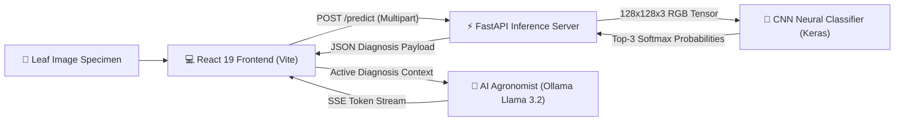

# 🌱 PlantCare AI - Crop Disease Diagnosis & GenAI Agronomist

<div align="center">


<p align="center">
  <b>A Production-Ready, Privacy-First Agricultural Diagnostic Platform</b><br>
  Combining Convolutional Neural Networks (CNN) with Local GenAI (Ollama Llama 3.2) to diagnose 67 crop foliar pathologies in real-time.
</p>

</div>

---

## 📌 Overview

**PlantCare AI** is an intelligent agricultural web application designed to help farmers, agronomists, and researchers rapidly diagnose plant leaf diseases, inspect infection probabilities, and receive immediate organic and chemical advisory through a conversational GenAI agronomist.

The system pairs a high-performance **FastAPI + TensorFlow CNN** backend with a modern **React 19 + Vite + Tailwind CSS** frontend, seamlessly communicating with a local **Ollama** engine for zero-data-leakage plant care recommendations.

---

## ✨ Key Features

- 🔬 **67-Class CNN Pathology Classifier**: Detects early/late blights, rusts, scabs, bacterial spots, viruses, and healthy states across multiple crop families (Apple, Tomato, Potato, Corn, Grape, Strawberry, etc.).
- 🤖 **Context-Aware AI Agronomist Chatbot**: Powered locally by **Ollama (`llama3.2`)**, automatically receives leaf diagnosis data to provide targeted organic remedies (neem oil, copper spray), cultural pruning controls, and chemical dosages without medical refusals.
- ⚡ **Sub-Second Real-Time Inference**: Accepts JPG, PNG, and WEBP leaf specimens, normalizes 128×128×3 RGB tensors, and returns softmax probability distributions.
- 📊 **Diagnostic Dashboard & Metrics**: Real-time counters for Analyzed Specimens, Detected Issues, Healthy Crops, and Average Model Certainty with interactive Recharts visualizations.
- 📜 **Client-Side History & Audit**: Persistent `localStorage` tracking with preview thumbnails, search, filters, and one-click JSON/CSV data export.
- 🛡️ **100% Offline & Private**: Zero external cloud API dependencies. Both model inference and GenAI chat run completely on your local machine.

---

## 🏗️ System Architecture



---

## 🛠️ Tech Stack

| Layer | Technologies |
| :--- | :--- |
| **Frontend** | React 19, Vite, Tailwind CSS, Lucide React, Recharts, React Router DOM v7 |
| **Backend API** | FastAPI, Uvicorn, Python 3.9+, HTTPX |
| **Deep Learning** | TensorFlow / Keras (39-Layer CNN Architecture), Pillow, NumPy |
| **GenAI Chatbot** | Ollama Local LLM (`llama3.2:latest`, `llama3.1`, `mistral`) via Server-Sent Events |
| **Persistence** | Browser `localStorage` (Zero-database setup required) |

---

## 🚀 Quickstart Guide

### 1. Prerequisites
- **Python**: 3.9 or higher
- **Node.js**: v18+ (Node v20+ recommended)
- **Ollama**: Download from [ollama.com](https://ollama.com) and pull `llama3.2`

---

### 2. Start Ollama (GenAI Chat Engine)
Open a terminal and start the lightweight `llama3.2` model:
```bash
ollama run llama3.2
```

---

### 3. Run FastAPI Backend
In the project root directory:
```bash
# 1. Install dependencies
pip install -r requirement.txt

# 2. Launch FastAPI with hot-reload
python -m uvicorn main:app --host 127.0.0.1 --port 8000 --reload
```
- API Base: `http://localhost:8000`
- Swagger Interactive Docs: `http://localhost:8000/docs`
- Health Telemetry: `http://localhost:8000/health`

---

### 4. Run React Frontend
In a new terminal window:
```bash
cd frontend

# 1. Install dependencies
npm install

# 2. Start development server
npm run dev
```
Open your browser at: **`http://localhost:5173`**

To create an optimized production build:
```bash
npm run build
npm run preview
```

---

## 📡 API Reference

### Health Status Probe
```http
GET /health
```
```json
{
  "status": "healthy",
  "model_loaded": true,
  "model_name": "Plant Disease CNN",
  "framework": "TensorFlow/Keras",
  "image_size": "128 x 128 x 3",
  "num_classes": 67,
  "ollama": {
    "online": true,
    "default_model": "llama3.2"
  }
}
```

### Disease Prediction
```http
POST /predict
Content-Type: multipart/form-data
file: <leaf_image.jpg>
```
```json
{
  "predicted_class": "Tomato___Tomato_Early_blight",
  "confidence": 98.4,
  "status": "success",
  "top_predictions": [
    { "class_name": "Tomato___Tomato_Early_blight", "confidence": 98.4 },
    { "class_name": "Tomato___Tomato_Late_blight", "confidence": 1.2 },
    { "class_name": "Tomato___Tomato_Target_Spot", "confidence": 0.4 }
  ]
}
```

### GenAI Chatbot Completion
```http
POST /api/chat
Content-Type: application/json
```
Streams Server-Sent Events (SSE) tokens directly from the local Ollama instance.

---

## 📂 Project Structure

```
PlantCare-AI/
├── main.py                      # FastAPI server with CNN inference & Chatbot router
├── chatbot.py                   # GenAI Agronomist service (Ollama SSE streaming)
├── class_names.json             # 67-class plant pathology taxonomy
├── plant_disease_model.keras    # Pre-trained CNN model weights
├── requirement.txt              # Core Python dependencies
├── README.md                    # Public documentation & guides
├── .gitignore                   # Production git ignores
│
└── frontend/                    # React 19 + Vite frontend
    ├── index.html               # Entry HTML shell
    ├── package.json             # Frontend dependencies
    ├── vite.config.js           # Vite configuration
    ├── tailwind.config.js       # Custom agricultural styling
    └── src/
        ├── api/plantApi.js      # API client for health, predictions, & chat
        ├── components/
        │   ├── common/          # Reusable Card, StatusBadge, EmptyState
        │   ├── layout/          # Navbar, Sidebar, Layout wrapper
        │   ├── dashboard/       # Metrics, DiseaseChart, RecentTable
        │   ├── detection/       # Dropzone, ScanningState, ResultView
        │   └── history/         # HistoryTable, HistoryModal
        ├── context/
        │   ├── HistoryContext.jsx   # LocalStorage history provider
        │   └── SettingsContext.jsx  # Health probe & connection state
        ├── pages/
        │   ├── DashboardPage.jsx    # Diagnostic summary overview
        │   ├── DetectionPage.jsx    # Leaf upload & scanning studio
        │   ├── ChatPage.jsx         # AI Agronomist Chatbot
        │   └── HistoryPage.jsx      # Audit trail & CSV/JSON export
        └── utils/
            ├── diseaseFormatter.js  # Plant taxonomy & treatment advice
            └── exportUtils.js       # Data export helpers
```

---

## 🌾 Supported Crops & Pathologies

PlantCare AI detects diseases across **67 distinct categories**, including:
- **Apple**: Apple Scab, Black Rot, Cedar Apple Rust, Healthy
- **Corn (Maize)**: Cercospora Leaf Spot, Common Rust, Northern Leaf Blight, Healthy
- **Grape**: Black Rot, Esca (Black Measles), Leaf Blight, Healthy
- **Peach**: Bacterial Spot, Healthy
- **Pepper (Bell)**: Bacterial Spot, Healthy
- **Potato**: Early Blight, Late Blight, Healthy
- **Strawberry**: Leaf Scorch, Healthy
- **Tomato**: Bacterial Spot, Early Blight, Late Blight, Leaf Mold, Septoria Leaf Spot, Spider Mites, Target Spot, Yellow Leaf Curl Virus, Mosaic Virus, Healthy
- *...and more.*

---

## 📄 License

This project is open-source under the [MIT License](LICENSE).

---

<div align="center">
  <b>Developed for Agricultural Health & Sustainable Crop Protection</b> 🌱
</div>
